<p align="center">
  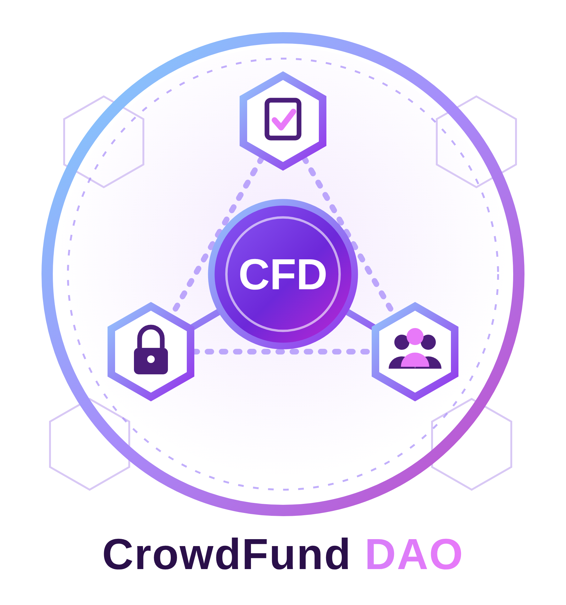
</p>

<h1 align="center">CrowdFund DAO</h1>

<p align="center">
  Plateforme de financement participatif décentralisée à gouvernance par jeton<br>
  <b>Solidity · Hardhat · OpenZeppelin v5 · React · Ethers.js v6 · MetaMask · IPFS (Pinata) · Python</b>
</p>

<p align="center">
  Mini-projet du module Blockchain · ENSA Béni Mellal · Filière Intelligence Artificielle et Cybersécurité · 2026/2027
</p>

---

## Sommaire

1. [Le projet](#le-projet)
2. [Architecture](#architecture)
3. [Paramètres de la plateforme](#paramètres-de-la-plateforme)
4. [Sécurité](#sécurité)
5. [Tests, fuzzing et audit Slither](#tests-fuzzing-et-audit-slither)
6. [La dApp](#la-dapp)
7. [Déploiement sur Sepolia](#déploiement-sur-sepolia)
8. [Bonus : détection de fraude en Python](#bonus--détection-de-fraude-en-python)
9. [Installation et lancement](#installation-et-lancement)
10. [Structure du dépôt](#structure-du-dépôt)
11. [Auteures](#auteures)

---

## Le projet

Sur une plateforme de crowdfunding classique, l'opérateur garde l'argent et décide seul quand le débloquer.
**CrowdFund DAO** remplace cette confiance par des **smart contracts** :

1. Un contributeur envoie des ETH à une campagne.
2. Il reçoit automatiquement des jetons de gouvernance **CFD** (1 ETH = 1 000 CFD).
3. Les décisions sensibles (débloquer des fonds en avance, geler une campagne suspecte) sont **votées** par les détenteurs de CFD.
4. La décision est exécutée automatiquement après un **timelock**. Les gros retraits passent par un **coffre multisignature 2-sur-3**.

Les fonds restent dans le contrat : rien ne sort sans un vote de la DAO.

## Architecture

| Contrat | Rôle |
|---|---|
| `CFDToken.sol` | Jeton ERC-20 + ERC20Votes (historique des soldes pour le snapshot), frappé uniquement par Crowdfunding |
| `Crowdfunding.sol` | Cœur : campagnes, contributions, remboursements, retraits, 4 statuts |
| `Governance.sol` | Propositions, votes pondérés au snapshot, quorum, timelock, exécution |
| `MultiSigTreasury.sol` | Coffre 2-sur-3 pour les retraits au-delà de 5 ETH cumulés |

Hors chaîne : la **dApp React** (sans serveur), **IPFS** via Pinata pour l'image et la description (seul le CID est stocké on-chain), et un **script Python** d'analyse des événements.

Ordre de déploiement : `CFDToken → MultiSigTreasury → Crowdfunding → Governance`, puis distribution des rôles et renonciation du déployeur au rôle `DEFAULT_ADMIN_ROLE`.

## Paramètres de la plateforme

| Paramètre | Valeur | Justification |
|---|---|---|
| Taux | 1 ETH = 1 000 CFD | Même 18 décimales, conversion sans arrondi |
| Quorum | 20 % du supply au snapshot | Une petite minorité ne décide pas seule |
| Majorité | OUI > NON (égalité = rejet) | Majorité simple des voix exprimées |
| Snapshot | `block.number - 1` | Impossible d'acheter des jetons et voter dans la même transaction |
| Période de vote / timelock | 3 jours / 1 jour (paramétrables) | Le temps de réagir à un vote malveillant |
| Expiration | 7 jours après le timelock | Une décision ne reste pas exécutable indéfiniment |
| Seuil de proposition | 100 CFD | Limite le spam de propositions |
| Seuil multisig | 5 ETH **cumulés** | Impossible de découper un gros retrait |
| Remboursement | proportionnel + burn des CFD | Pas de droit de vote gratuit après remboursement |

## Sécurité

- **Reentrance** : pattern Checks-Effects-Interactions + `nonReentrant` sur toutes les fonctions qui envoient de l'ETH (attaque testée avec `ReentrancyAttacker.sol`).
- **Contrôle d'accès** : `AccessControl` (minter, gouvernance, pause), l'admin renonce à ses super-rôles.
- **Circuit breaker** : `Pausable`, l'admin ne garde que la pause et ne peut jamais déplacer des fonds.
- **Multisig 2-sur-3** au-delà de 5 ETH cumulés, destinataire fixé par Crowdfunding.
- **Snapshot** : les voix sont lues avec `getPastVotes` au bloc précédant la proposition.
- **Audit Slither** : 0 finding critique.

**Attaque démontrée** : Mallory contribue 20 ETH juste après la création d'une proposition. Son vote est refusé, car elle avait 0 voix au snapshot.

<p align="center">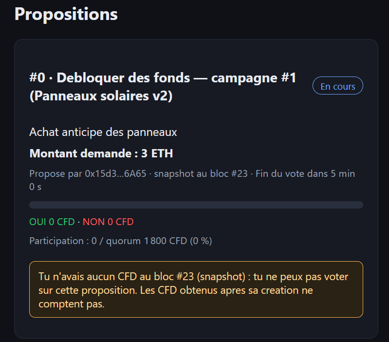</p>

## Tests, fuzzing et audit Slither

- **46 tests** Hardhat (Mocha/Chai), tous verts.
- **Fuzzing** avec une graine fixe (`FUZZ_SEED=2026`) : 3 propriétés sur 600 scénarios aléatoires.
- **Slither** : 15 findings, aucun critique → 3 corrigés, 12 justifiés (`timestamp`, `low-level-calls`).

<p align="center">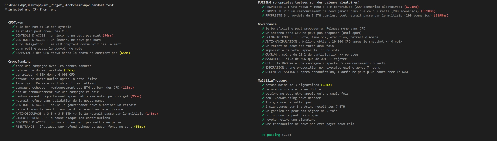</p>
<p align="center">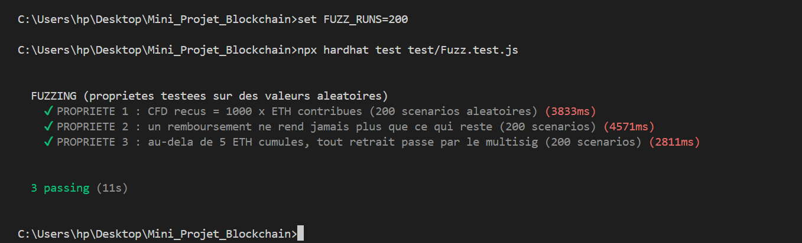</p>
<p align="center">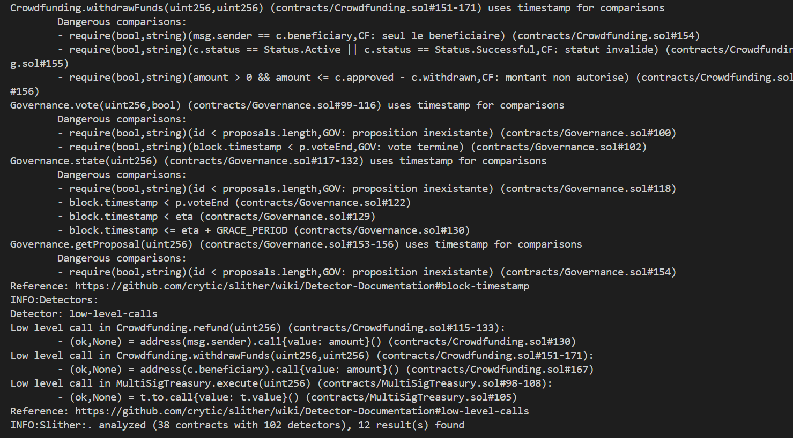</p>

## La dApp

| Campagnes (IPFS) | Gouvernance | Multisig |
|---|---|---|
| 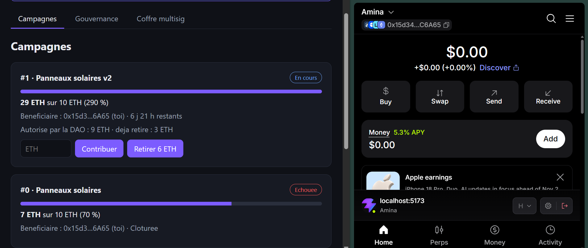 |  | 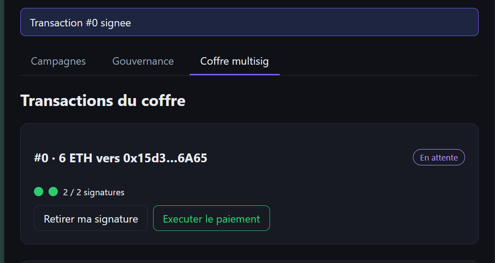 |

<p align="center">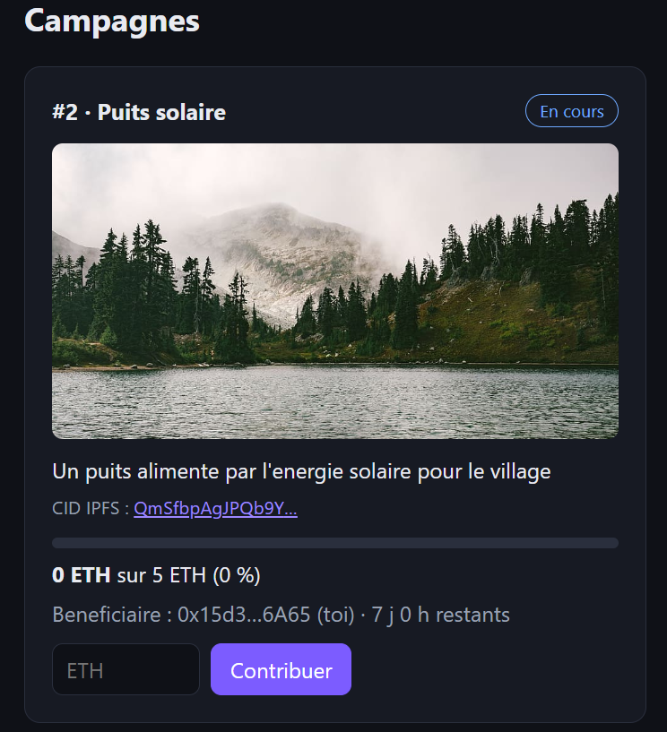</p>

## Déploiement sur Sepolia

Déployé le 5 novembre 2026 (chainId 11155111).

| Contrat | Adresse |
|---|---|
| CFDToken | [`0x46161e71DDF8FcE90a105dc2bDfFA383A62Ce40b`](https://sepolia.etherscan.io/address/0x46161e71DDF8FcE90a105dc2bDfFA383A62Ce40b) |
| MultiSigTreasury | [`0x0B72ECF150599ed91a75A4016f1e61fA1437e81d`](https://sepolia.etherscan.io/address/0x0B72ECF150599ed91a75A4016f1e61fA1437e81d) |
| Crowdfunding | [`0x3C5F137C139142Dd20Ce6c361D3685cdaCEF680f`](https://sepolia.etherscan.io/address/0x3C5F137C139142Dd20Ce6c361D3685cdaCEF680f) |
| Governance | [`0x03e67Af862702A04953860477AD152699CeC2409`](https://sepolia.etherscan.io/address/0x03e67Af862702A04953860477AD152699CeC2409) |

Scénario réel rejoué : campagne avec image IPFS → contribution de 0,01 ETH → proposition → vote → timelock → exécution → retrait de 0,005 ETH.

<p align="center">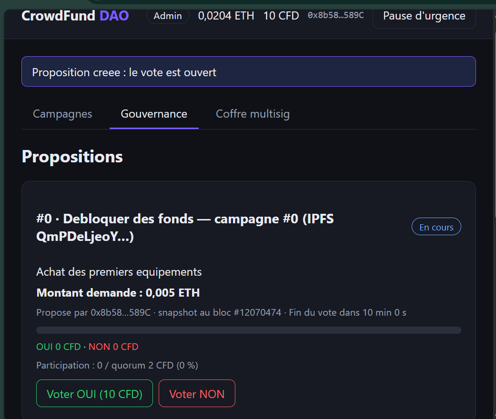</p>
<p align="center">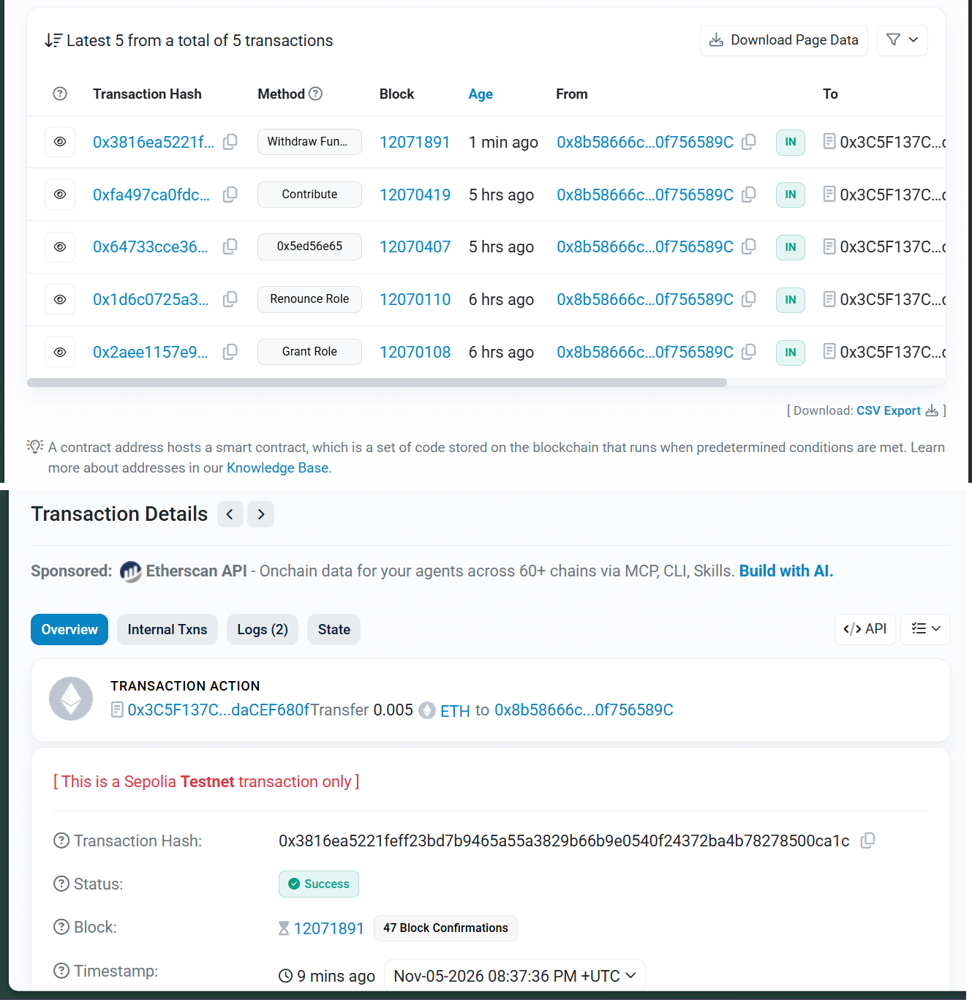</p>

## Bonus : détection de fraude en Python

`scripts/detect_anomalies.py` (web3.py) lit les événements `Contributed` et applique 3 règles :

| Règle | Signal |
|---|---|
| R1 | Montants identiques envoyés par au moins 3 adresses |
| R2 | Au moins 3 contributeurs financés par la même adresse |
| R3 | Pic : au moins 5 contributions en 10 minutes |

Fraude simulée (`scripts/simuler-fraude.js`) : Mallory finance sa propre campagne via 6 faux comptes → **score 3/3**. Le script recommande, c'est la DAO qui vote le gel.

<p align="center">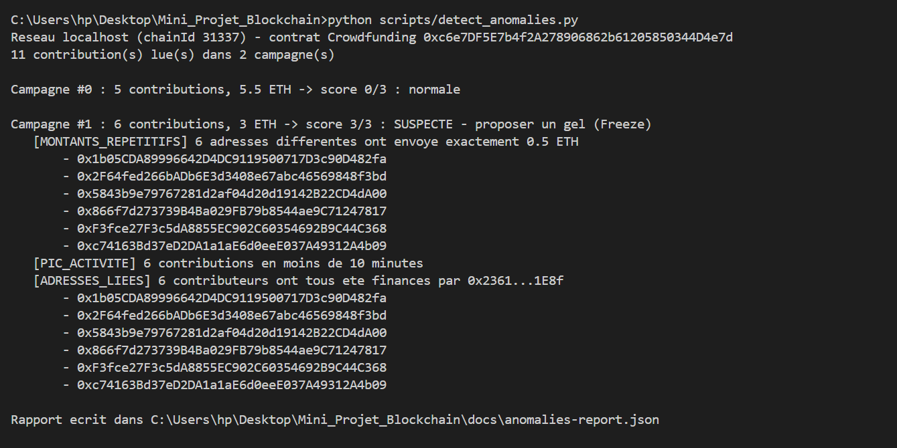</p>

## Installation et lancement

Prérequis : Node.js 18+, npm, Git, MetaMask, Python 3.10+ (pour le bonus).

```bash
# 1. Cloner et installer
git clone https://github.com/sabrine-ouarchane/crowdfund-dao.git
cd crowdfund-dao
npm install
cd frontend && npm install && cd ..

# 2. Compiler et tester
npx hardhat compile
npx hardhat test

# 3. Blockchain locale (terminal 1)
npx hardhat node

# 4. Déployer en local (terminal 2)
npx hardhat run scripts/deploy.js --network localhost

# 5. Lancer la dApp (terminal 3)
cd frontend
npm run dev
```

Pour avancer le temps en local, lancez `npx hardhat run scripts/avancer-temps.js --network localhost` en définissant d'abord la variable `SECONDES`.

### Variables d'environnement

Copier `.env.example` en `.env` (racine) et `frontend/.env.example` en `frontend/.env`, puis remplir les valeurs.
**Les fichiers `.env` ne sont jamais versionnés.**

### Bonus Python

```bash
pip install web3
python scripts/detect_anomalies.py
```

## Structure du dépôt

```
contracts/            CFDToken, Crowdfunding, Governance, MultiSigTreasury (+ test/ReentrancyAttacker)
test/                 46 tests dont Fuzz.test.js
scripts/              deploy.js, avancer-temps.js, simuler-fraude.js, detect_anomalies.py
frontend/             dApp React (Vite) + Ethers.js
docs/                 adresses de déploiement, rapport, présentation, captures (docs/images)
hardhat.config.js
```

## Auteures

- **Sabrine OUARCHANE**
- **Salwa HAMDAOUI**

Encadré par **Pr. Hamza TOUIL**, ENSA Béni Mellal.

> Projet académique déployé sur un testnet. Les contrats n'ont pas fait l'objet d'un audit professionnel : ne pas les utiliser avec de vrais fonds.
